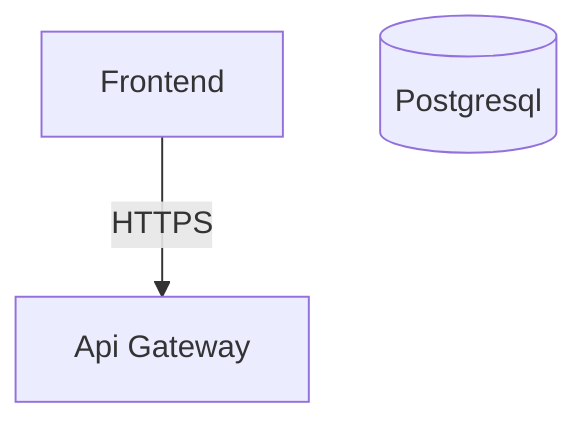

# The Ghost Architect (TGA)

The Ghost Architect is a prototype generative system engineering tool. It listens to, or reads, architecture discussions and turns them into practical engineering assets:

- A live architecture diagram
- Extracted services, databases, APIs, queues, and relationships
- A generated architecture manifesto
- A starter codebase scaffold with service folders, Dockerfiles, README files, and Docker Compose
- Browser microphone recording for direct voice-to-diagram generation

In simple words: you describe a system in a meeting, and TGA tries to build the first architecture draft for you.

## What Problem This Solves

In technical meetings, engineers often say things like:

```text
Frontend talks to API gateway.
API gateway routes login requests to auth service.
Auth service stores users in PostgreSQL.
Payment service calls Stripe API.
```

Usually, after the meeting someone must manually:

- Draw the architecture diagram
- Write documentation
- Decide what services and databases were mentioned
- Create project folders and boilerplate files

TGA automates the first draft of that work.

## High-Level Flow

```text
User text or audio
        |
        v
Streamlit UI (app.py)
        |
        v
FastAPI backend (main.py)
        |
        v
Audio transcription, if audio was uploaded
scripts/audio_pipeline.py
        |
        v
Architecture extraction using local LLM
scripts/architecture_extraction_pipeline.py
        |
        v
Shared architecture state
services, databases, APIs, queues, relationships
        |
        +--> Mermaid diagram
        |    scripts/mermaid_generator.py
        |
        +--> Blueprint JSON
        |    scripts/blueprint_generator.py
        |
        +--> Project scaffold
        |    scripts/scaffold_generator.py
        |
        +--> Architect's Manifesto
             scripts/manifesto_generator.py
```

## Main Technologies

| Area | Technology | Purpose |
| --- | --- | --- |
| Frontend | Streamlit | Web UI for text/audio input, browser recording, live diagram, entities, and export |
| Backend | FastAPI | API server that receives input, processes data, and exposes state |
| Live updates | Streamlit autorefresh + `/state` polling | Updates UI every second without background Streamlit threads |
| Audio transcription | Faster-Whisper | Converts uploaded or browser-recorded meeting audio into text chunks |
| Browser recording | MediaRecorder API | Records microphone audio inside the Streamlit page and sends it to FastAPI |
| Local LLM inference | llama.cpp / `llama-cpp-python` | Runs a local GGUF LLM on CPU |
| Model file | `models/llm/model.gguf` | Quantized local language model used for extraction and manifesto |
| Diagram | Mermaid.js | Renders the architecture graph |
| Scaffold generation | Python file generation | Creates service folders and boilerplate code |
| Packaging | ZIP | Downloads generated project as `generated_project.zip` |

## Which Part Is ML, DL, NLP, and Generative AI?

### Machine Learning (ML)

ML is the broad idea of using trained models to make predictions or extract meaning from data.

In this project:

- Faster-Whisper detects speech and converts it to text.
- The local LLM reads architecture discussion and extracts structured entities.

### Deep Learning (DL)

DL is a type of ML that uses neural networks with many layers.

In this project:

- Whisper/Faster-Whisper is a deep learning speech recognition model.
- The GGUF LLM is a deep learning transformer model.

### Natural Language Processing (NLP)

NLP means understanding or generating human language.

In this project:

- Meeting text is analyzed to find services, databases, APIs, and relationships.
- The model ignores small talk and extracts architecture intent.
- The manifesto generator turns architecture JSON into readable Markdown.

### Generative AI

Generative AI creates new content from prompts.

In this project:

- The LLM generates structured architecture JSON from meeting language.
- The LLM generates the Architect's Manifesto.
- The project scaffold generator creates starter files from the extracted architecture.

## Important Folders

| Path | Purpose |
| --- | --- |
| `app.py` | Streamlit frontend |
| `main.py` | FastAPI backend |
| `scripts/` | Core processing modules |
| `models/llm/model.gguf` | Local quantized LLM file |
| `input/` | Input audio files |
| `input/uploads/` | Uploaded meeting audio from Streamlit |
| `output/` | Generated JSON and Markdown outputs |
| `generated_project/` | Generated codebase scaffold |
| `generated_project.zip` | Downloadable scaffold ZIP |
| `tga-env/` | Local Python virtual environment |

## File-by-File Explanation

### `app.py`

This is the Streamlit frontend.

It does the following:

- Shows the project UI in the browser
- Lets the user write a context prompt
- Lets the user paste architecture text
- Lets the user upload audio
- Lets the user record voice directly from the browser microphone
- Calls backend APIs in `main.py`
- Polls `/state` every second
- Renders the live Mermaid diagram
- Shows extracted entities
- Downloads the generated project ZIP

Important backend calls:

| UI Action | Backend API |
| --- | --- |
| Save Context | `POST /set-context` |
| Generate Diagram | `POST /start-session-text` |
| Process Audio | `POST /upload-file`, then `POST /start-session` |
| Record Voice | Browser records `.webm`, then calls `POST /upload-file` and `POST /start-session` |
| Stop Processing | `POST /stop-session` |
| Reset Session | `POST /reset-session` |
| Generate Project | `POST /generate-scaffold` |
| Open Project Folder | `GET /open-folder` |
| Live update polling | `GET /state` |
| Processing status polling | `GET /status` |

### `main.py`

This is the FastAPI backend.

It does the following:

- Receives text input from Streamlit
- Receives uploaded audio files
- Receives browser-recorded audio files
- Starts text or audio processing
- Stores the latest extracted architecture state
- Provides `/state` so Streamlit can update every second
- Generates blueprint, manifesto, scaffold, and ZIP file
- Keeps SSE `/stream` available, although Streamlit currently uses polling

Main API endpoints:

| Endpoint | Method | Purpose |
| --- | --- | --- |
| `/set-context` | POST | Saves optional project context |
| `/start-session-text` | POST | Processes pasted architecture text |
| `/upload-file` | POST | Uploads MP3/WAV/M4A/WEBM audio, including browser recordings |
| `/start-session` | POST | Transcribes uploaded or recorded audio and processes chunks |
| `/stop-session` | POST | Stops current processing |
| `/reset-session` | POST | Clears extracted state |
| `/state` | GET | Returns latest architecture state |
| `/status` | GET | Returns current processing stage, chunk count, and latest chunk |
| `/status-event` | POST | Lets the browser recorder report recording/uploading status |
| `/generate-scaffold` | POST | Generates blueprint, manifesto, project folder, and ZIP |
| `/open-folder` | GET | Opens generated project folder locally |
| `/stream` | GET | SSE stream kept for backend compatibility |

### `scripts/audio_pipeline.py`

This file handles audio transcription.

It uses Faster-Whisper:

```python
WhisperModel("base", compute_type="int8")
```

Purpose:

- Load a CPU-friendly speech-to-text model
- Read uploaded audio
- Yield transcript chunks one by one

Input:

```text
input/uploads/meeting.wav
```

Output:

```text
Frontend talks to API gateway
API gateway talks to auth service
Auth service uses PostgreSQL
```

### `scripts/architecture_extraction_pipeline.py`

This is the core AI extraction pipeline.

It does the following:

- Loads the local GGUF model using llama.cpp
- Sends each transcript/text chunk to the model
- Asks the model to behave like a Senior System Architect
- Forces the model to return JSON
- Parses the JSON
- Merges new architecture into global state
- Saves the state to `output/architecture_state.json`

The global state looks like this:

```json
{
  "services": [],
  "databases": [],
  "apis": [],
  "message_queues": [],
  "relationships": []
}
```

Relationship example:

```json
{
  "from": "frontend",
  "to": "api gateway",
  "protocol": "https"
}
```

### `scripts/llm_engine.py`

This is an older/alternate LLM extraction engine.

Current role:

- Used only as fallback if direct llama.cpp loading is unavailable in `architecture_extraction_pipeline.py`
- Also demonstrates how raw LLM extraction works

Important note:

- This file loads the model when imported.
- The main pipeline avoids importing it unless needed, to prevent loading the same GGUF model twice.

### `scripts/mermaid_generator.py`

This file converts architecture state into Mermaid diagram code.

Input:

```json
{
  "services": ["frontend", "api gateway"],
  "databases": ["postgresql"],
  "relationships": [
    {"from": "frontend", "to": "api gateway", "protocol": "https"}
  ]
}
```

Output:



Streamlit then renders this using Mermaid.js.

### `scripts/blueprint_generator.py`

This file creates a JSON blueprint for the generated project.

It reads the current architecture state and creates a file/folder plan.

Example:

```json
{
  "auth-service": {
    "main.py": "...",
    "requirements.txt": "...",
    "Dockerfile": "...",
    "README.md": "..."
  },
  "docker-compose.yml": "...",
  ".env.example": "...",
  ".gitignore": "..."
}
```

Output:

```text
output/blueprint.json
```

### `scripts/scaffold_generator.py`

This file physically creates the generated project.

It does the following:

- Reads `output/blueprint.json`
- Creates `generated_project/`
- Creates one folder per service
- Adds FastAPI starter code
- Adds Dockerfiles
- Adds `requirements.txt`
- Adds service README files
- Adds `docker-compose.yml`
- Adds `.gitignore`
- Adds `.env.example`
- Adds `ARCHITECTS_MANIFESTO.md` if available
- Runs local git initialization

Example output:

```text
generated_project/
  auth-service/
    main.py
    Dockerfile
    requirements.txt
    README.md
  api-gateway/
    main.py
    Dockerfile
    requirements.txt
    README.md
  docker-compose.yml
  .env.example
  .gitignore
  ARCHITECTS_MANIFESTO.md
```

### `scripts/manifesto_generator.py`

This file generates the Architect's Manifesto.

It uses the local LLM to turn architecture JSON into Markdown documentation.

Input:

```text
Current architecture state
```

Output:

```text
output/ARCHITECTS_MANIFESTO.md
```

The manifesto includes:

- Overview
- Components
- Decisions and rationale
- Open questions

### Other Scripts

Some files are helper, experimental, or earlier-stage versions:

| File | Purpose |
| --- | --- |
| `scripts/server.py` | Older backend prototype |
| `scripts/file_transcription.py` | Older file transcription workflow |
| `scripts/live_transcription.py` | Experimental live microphone transcription |
| `scripts/test_transcription.py` | Transcription test script |
| `scripts/transcript_chunking.py` | Earlier chunking experiment |
| `scripts/convert.py` | Utility script, likely for conversion work |

The main working flow currently uses:

```text
app.py
main.py
scripts/audio_pipeline.py
scripts/architecture_extraction_pipeline.py
scripts/mermaid_generator.py
scripts/blueprint_generator.py
scripts/manifesto_generator.py
scripts/scaffold_generator.py
```

## Main Script And Model Descriptions

### `app.py` - Streamlit User Interface

This file is the visible application that runs in the browser. It contains the context prompt, text input, uploaded audio input, browser microphone recorder, diagram panel, entity panel, and export buttons. It does not run the AI model directly; it sends requests to the FastAPI backend. It also polls `/state` every second so the diagram updates reliably as text or voice is processed.

### `main.py` - FastAPI Backend Orchestrator

This file is the central controller for the project. It receives text, uploaded audio, and browser-recorded audio from the Streamlit app. It sends chunks into the extraction pipeline, exposes the latest architecture through `/state`, and controls stop/reset behavior. It also coordinates blueprint generation, manifesto generation, scaffold creation, ZIP packaging, and folder opening.

### `scripts/audio_pipeline.py` - Speech-To-Text Module

This file converts audio into text. It uses Faster-Whisper with an int8 CPU configuration so the project can run locally without needing a GPU. It accepts uploaded or browser-recorded audio files and yields transcript chunks. These chunks are treated the same as text input and sent into the architecture extraction pipeline.

### `scripts/architecture_extraction_pipeline.py` - Architecture Extraction Module

This is the main NLP and GenAI processing file. It loads the local GGUF model through llama.cpp and prompts it to act like a Senior System Architect. For every text or transcript chunk, it extracts services, databases, APIs, message queues, and relationships as JSON. It merges those results into a shared state and saves that state to `output/architecture_state.json`.

### `scripts/llm_engine.py` - Fallback LLM Module

This file is an alternate LLM extraction implementation. The main extraction pipeline only imports it if direct llama.cpp loading is unavailable, because importing it can load the same model twice. It is useful as a fallback and as a simple reference for raw model prompting. In a production cleanup, this could be merged into a single model-service abstraction.

### `scripts/mermaid_generator.py` - Diagram Code Module

This file converts architecture JSON into Mermaid graph code. It creates nodes for services and databases, then creates arrows for relationships. Streamlit sends that Mermaid code to Mermaid.js so the browser can render the visual diagram. This module is deterministic, meaning it does not use AI; it simply converts structured state into diagram syntax.

### `scripts/blueprint_generator.py` - Blueprint Module

This file creates the plan for the generated codebase. It reads the current architecture state and decides which service folders and root project files should exist. It writes that plan into `output/blueprint.json`. The scaffold generator later reads this blueprint and turns it into real folders and files.

### `scripts/scaffold_generator.py` - Project Scaffold Module

This file physically creates the generated project folder. It reads `output/blueprint.json`, creates service folders, writes FastAPI starter code, Dockerfiles, requirements files, and README files. It also creates root files like `docker-compose.yml`, `.env.example`, and `.gitignore`. If the Architect's Manifesto exists, it copies it into the generated project too.

### `scripts/manifesto_generator.py` - Documentation Module

This file generates the Architect's Manifesto. It sends the extracted architecture state to the local LLM and asks for a professional Markdown architecture document. The output explains the system overview, components, decisions, rationale, and open questions. This is the documentation-generation part of the GenAI workflow.

### `models/llm/model.gguf` - Local AI Model

This is the local quantized language model used by llama.cpp. GGUF quantization makes the model smaller and more practical for CPU-based machines. It powers architecture extraction and manifesto generation. The better this model is, the better TGA can understand meeting language and produce useful engineering outputs.

## Runtime Flow: Text to Diagram

1. User opens Streamlit at `http://localhost:8501`.
2. User enters optional context prompt.
3. User pastes architecture text.
4. User clicks `Generate Diagram`.
5. `app.py` sends text to:

```text
POST http://localhost:8000/start-session-text
```

6. `main.py` splits text into chunks.
7. Each chunk goes to:

```text
scripts/architecture_extraction_pipeline.py
```

8. The local LLM extracts architecture JSON.
9. State is updated in memory and saved to:

```text
output/architecture_state.json
```

10. `app.py` polls:

```text
GET http://localhost:8000/state
```

11. `app.py` rebuilds Mermaid code using:

```text
scripts/mermaid_generator.py
```

12. Streamlit renders the updated diagram.

## Runtime Flow: Uploaded Audio to Diagram

1. User uploads MP3/WAV/M4A/WEBM in Streamlit.
2. `app.py` sends audio to:

```text
POST http://localhost:8000/upload-file
```

3. `main.py` saves the file into:

```text
input/uploads/
```

4. User clicks `Process Audio`.
5. `app.py` calls:

```text
POST http://localhost:8000/start-session
```

6. `scripts/audio_pipeline.py` transcribes audio using Faster-Whisper.
7. Transcript chunks are processed by the LLM extraction pipeline.
8. Architecture state updates.
9. Streamlit polls `/state` every second.
10. Diagram and entity list update live.

## Runtime Flow: Browser Voice Recording to Diagram

1. User clicks `Start Recording` in the Streamlit sidebar.
2. The browser asks for microphone permission.
3. The browser records speech using the built-in MediaRecorder API.
4. User clicks `Stop & Process`.
5. The embedded recorder sends the `.webm` audio to:

```text
POST http://localhost:8000/upload-file
```

6. `main.py` saves the recording into:

```text
input/uploads/browser_recording.webm
```

7. The recorder then calls:

```text
POST http://localhost:8000/start-session
```

8. `scripts/audio_pipeline.py` transcribes the recording using Faster-Whisper.
9. Transcript chunks are sent to the architecture extraction pipeline.
10. Streamlit polls `/state` every second and updates the diagram live.

## Runtime Flow: Generate Project

1. User clicks `Generate Project`.
2. `app.py` calls:

```text
POST http://localhost:8000/generate-scaffold
```

3. `main.py` gets the current architecture state.
4. `scripts/blueprint_generator.py` creates:

```text
output/blueprint.json
```

5. `scripts/manifesto_generator.py` creates:

```text
output/ARCHITECTS_MANIFESTO.md
```

6. `scripts/scaffold_generator.py` creates:

```text
generated_project/
```

7. `main.py` zips it into:

```text
generated_project.zip
```

8. Streamlit provides the download button.

## How To Run

Open two terminals from the project root:

```powershell
cd D:\Task\TGA
```

Terminal 1: backend

```powershell
uvicorn main:app --reload
```

Terminal 2: frontend

```powershell
streamlit run app.py
```

Open:

```text
http://localhost:8501
```

Backend API runs at:

```text
http://localhost:8000
```

## Example Text Input

Paste this into the Streamlit text box:

```text
Frontend talks to API gateway using HTTPS
API gateway routes login requests to auth service
Auth service stores user accounts in PostgreSQL
API gateway routes payment requests to payment service
Payment service calls Stripe API using REST
Payment service stores transactions in PostgreSQL
Auth service publishes user-created events to Redis queue
Notification service consumes events from Redis queue
Notification service sends emails using SendGrid API
```

Expected extracted entities:

- Services: frontend, api gateway, auth service, payment service, notification service
- Database: PostgreSQL
- APIs: Stripe API, SendGrid API
- Queue: Redis queue
- Relationships between these components

## Why Context Prompt Exists

The context prompt gives background to the AI.

Example context:

```text
We are building a fintech app using Python FastAPI, PostgreSQL, Redis, and Stripe.
```

If the meeting says:

```text
The service should store transactions.
```

The model can better understand what "the service" and "transactions" may refer to.

The backend prepends this context to every text/audio chunk before extraction.

## Current Strengths

- Works locally
- Uses CPU-friendly quantized models
- Supports both text and uploaded audio
- Does not depend on cloud APIs
- Generates live architecture state
- Renders Mermaid diagrams
- Generates project scaffold
- Generates architecture manifesto
- Provides downloadable ZIP

## Current Limitations

- Live microphone streaming is not fully connected in the main UI yet.
- Uploaded audio works, but true real-time microphone capture would need extra UI/backend work.
- Extraction accuracy depends heavily on the local GGUF model quality.
- LLM JSON output can sometimes be invalid.
- Mermaid node handling is basic.
- Blueprint generation is simple and mostly service-folder based.
- The generated code is starter boilerplate, not production-ready business logic.
- Git initialization inside scaffold generation may fail if Git is not installed or configured.
- No authentication/security around backend endpoints.
- No database persistence for sessions; state is mostly in memory plus JSON output.

## What Needs Improvement

### 1. Better Model Reliability

Useful improvements:

- Use a stronger instruction-tuned GGUF model.
- Add JSON schema validation.
- Add automatic retry when model output is invalid.
- Add stricter prompt examples.
- Add confidence scores for extracted entities.

Helpful libraries:

- `pydantic` for validation
- `jsonschema` for JSON schema checking
- `outlines` or grammar-constrained decoding if compatible with the model stack

### 2. Better Audio Pipeline

Useful improvements:

- Add live microphone streaming.
- Split long audio into smaller chunks.
- Add timestamps.
- Keep raw transcript history.
- Show transcript alongside diagram.

Helpful libraries:

- `sounddevice` for microphone capture
- `pydub` or `ffmpeg` for audio chunking
- `faster-whisper` for transcription

### 3. Better Architecture Extraction

Useful improvements:

- Detect load balancers, caches, object storage, external vendors, and deployment targets.
- Merge duplicate names more intelligently.
- Understand synonyms like "DB", "database", "Postgres", "PostgreSQL".
- Track why each component was added.

Helpful techniques:

- Entity normalization
- Relationship deduplication
- Prompt few-shot examples
- Stateful memory of previous chunks

### 4. Better Diagram Generation

Useful improvements:

- Add node types for caches, queues, external APIs, and users.
- Add colors by component type.
- Add subgraphs for frontend/backend/data/external systems.
- Support D3.js or 3D visualization later.

Helpful libraries:

- Mermaid.js
- D3.js
- React Flow, if moving to a Vite frontend

### 5. Better Scaffold Generation

Useful improvements:

- Generate service-specific route names.
- Generate Docker Compose dependencies.
- Add database containers automatically.
- Add Redis container when queue/cache is detected.
- Add API gateway route placeholders.
- Add tests.

Helpful libraries/tools:

- Jinja2 templates
- Cookiecutter
- Docker Compose
- FastAPI
- Pytest

### 6. Better Product Experience

Useful improvements:

- Show processing status.
- Show transcript chunks as they are processed.
- Show model errors in the UI.
- Add session history.
- Add export buttons for Mermaid SVG, manifesto, blueprint JSON, and transcript.

## Recommended Future Architecture

For a more complete version:

```text
Streamlit or Vite frontend
        |
        v
FastAPI backend
        |
        +--> Audio service
        +--> Transcription service
        +--> Extraction service
        +--> Diagram service
        +--> Scaffold service
        +--> Manifesto service
        |
        v
Session database
```

Possible database:

- SQLite for local prototype
- PostgreSQL for production

Possible queue:

- Redis Queue
- Celery
- Dramatiq

## Development Notes

The current app uses polling instead of background Streamlit threads.

This is intentional because Streamlit does not reliably rerender when `st.session_state` is modified from a background thread. The app now uses:

```python
st_autorefresh(interval=1000)
```

and calls:

```text
GET /state
```

every second.

This makes live updates more reliable.

## Processing Status In The UI

The Streamlit app includes a processing status panel above the Mermaid diagram. This panel tells the user whether the system is idle, recording, uploading, transcribing, extracting architecture, updating the diagram, generating project files, completed, stopped, or in an error state. It also shows the current chunk being processed so the user can see what speech/text is currently affecting the diagram. The backend exposes this information through `/status`, and Streamlit polls it every second together with `/state`.

## Mental Model For Laymen

Think of the project like a factory:

```text
Meeting words go in
        |
        v
Speech-to-text machine turns audio into text
        |
        v
Architect AI reads the text
        |
        v
It writes down the system parts
        |
        v
Diagram machine draws the architecture
        |
        v
Documentation machine writes the manifesto
        |
        v
Scaffold machine creates starter code folders
```

That is the core idea of The Ghost Architect.
